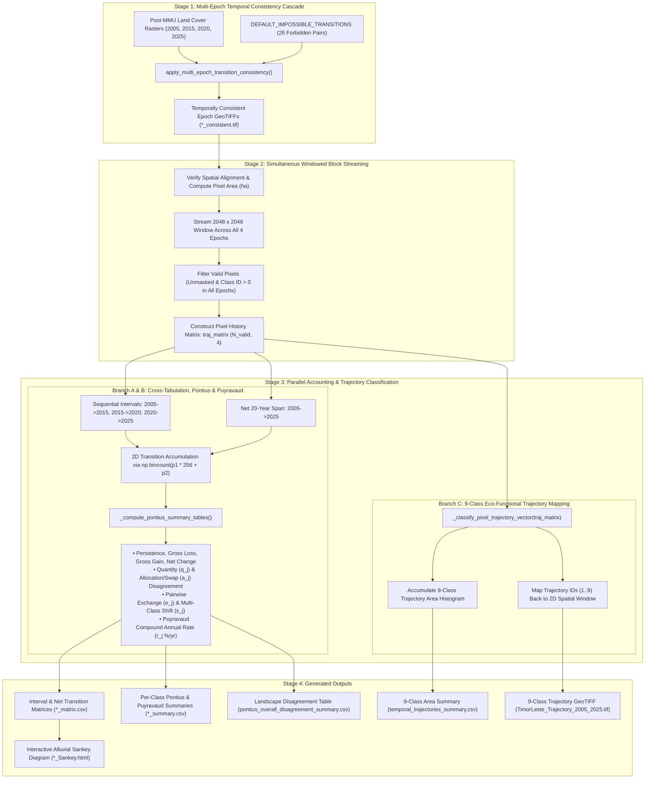
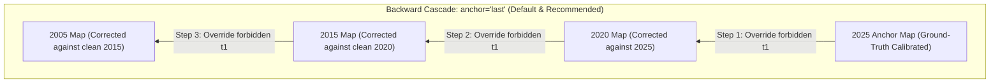

# Multi-Temporal Land Cover Change, Consistency & Trajectory Analysis

This document explains the end-to-end methodology, mathematical formulations, decision rules, and workflow architecture implemented in [`trajectory_analysis.py`](../src/ML_LC_Classifier/trajectory_analysis.py) and [`lc_post_process.py`](../src/ML_LC_Classifier/lc_post_process.py) for multi-epoch land-cover time series (`2005, 2015, 2020, 2025`) in Timor-Leste.

---

## 1. End-to-End Pipeline Architecture

The analysis is structured into four sequential stages:
1. **Stage 1 — Multi-Epoch Temporal Consistency Pre-Processing**: Eliminates ecologically impossible transitions across `2005, 2015, 2020, 2025` prior to statistical accounting.
2. **Stage 2 — Simultaneous Windowed Block Streaming**: Reads all 4 epoch GeoTIFFs in memory-safe $2048 \times 2048$ blocks and constructs per-pixel 4-epoch history vectors $[C_{2005}, C_{2015}, C_{2020}, C_{2025}]$.
3. **Stage 3 — Parallel Analytical Branches**:
   - **Branch A**: Cross-tabulation matrices for sequential intervals ($2005 \to 2015$, $2015 \to 2020$, $2020 \to 2025$) and the net 20-year span ($2005 \to 2025$).
   - **Branch B**: Pontius & Millones (2011) Quantity/Allocation Disagreement, Pontius & Santacruz (2014) Exchange/Shift decomposition, and Puyravaud (2003) annualized rates of change.
   - **Branch C**: Pixel-level classification into the **9 Eco-Functional Trajectory Classes**.
4. **Stage 4 — Outputs & Alluvial Visualization**: Exports wall-to-wall consistent GeoTIFFs, the 9-class Trajectory GeoTIFF, CSV statistical tables, and an interactive Plotly HTML Sankey diagram.



---

## 2. Stage 1: Multi-Epoch Temporal Consistency Analysis

Independent per-epoch Random Forest classifications can occasionally produce ecologically impossible transitions between consecutive dates due to seasonal spectral variations, topography/shadow effects, or sensor differences.

`apply_multi_epoch_transition_consistency()` enforces temporal consistency across the entire time series before computing transition matrices.

### 2.1 Backward vs. Forward Cascade Direction



- **Backward Cascade (`anchor="last"`, Default)**:
  - Uses the most recent epoch (`2025`, where field/reference training data are strongest) as the anchor truth and cascades backward (`2025 -> 2020 -> 2015 -> 2005`) with `correction_target="t1"`.
  - **Example**: If a pixel is mapped as **Primary Forest (`1`)** in `2025`, it could not have been **Secondary Forest (`2`)** or **Grassland (`13`)** in `2020, 2015, 2005`. The backward cascade overrides those earlier epochs to **Primary Forest (`1`)**, eliminating artificial "Primary Forest Gain" in the transition tables.
- **Forward Cascade (`anchor="first"`)**:
  - Uses the earliest epoch (`2005`) as the anchor and cascades forward (`2005 -> 2015 -> 2020 -> 2025`) with `correction_target="t2"`, reverting impossible later transitions back to their earlier state.

### 2.2 Default Ecologically Impossible Transitions

Defined in `DEFAULT_IMPOSSIBLE_TRANSITIONS`:

| Rule Category | Forbidden `(From_Class, To_Class)` Pairs | Ecological Justification |
| :--- | :--- | :--- |
| **Irreversible Primary Forest Loss** | `(2, 1), (3, 1), (4, 1), (5, 1), (6, 1), (7, 1), (8, 1), (9, 1), (10, 1), (11, 1), (12, 1), (13, 1), (14, 1), (15, 1), (16, 1), (17, 1), (18, 1)` | Primary old-growth forest (`1`) takes centuries to develop; no non-primary land cover can transition into Primary Forest within a 5–20 year window. (Natural forest recovery enters Secondary Forest `2`). |
| **Permanent Built-up / Settlement** | `(16, 2), (16, 3), (16, 4), (16, 7), (16, 8), (16, 11), (16, 12), (16, 13), (16, 14)` | Established urban/built-up settlements (`16`) do not revert to natural forests or smallholder crops; historical pixels showing this pattern are almost always bare-soil/riverbed commission errors in earlier epochs. |

> [!NOTE]
> **Why Stability & Confusion Index Maps Are Excluded from Post-MMU Trajectory Masking**
> During single-epoch assembly in `hybrid_assembly.py`, the Confusion Index ($\text{CI} = S_{\max}/W_{\max}$) is already used internally for adaptive segment weighting and false hydrology suppression. In multi-epoch trajectory analysis, wall-to-wall post-MMU maps are analyzed directly without masking out $\text{CI} > 0.65$ pixels because:
> 1. **Within-group ambiguity**: A pixel split between Primary Forest ($0.45$) and Secondary Forest ($0.42$) has high $\text{CI} = 0.93$, yet is $87\%$ certain to be Forest.
> 2. **Transitional landscapes**: Real regenerating fallows and swidden plots naturally have mixed sub-pixel canopies ($\text{CI} > 0.65$); masking them out would systematically underestimate real ecological transitions and violate Pontius wall-to-wall area accounting.

---

## 3. Stage 2 & 3A: Quantitative Change, Pontius Disagreement & Annual Rates

For every sequential period ($2005 \to 2015$, $2015 \to 2020$, $2020 \to 2025$) and the net 20-year span ($2005 \to 2025$), `_compute_pontius_summary_tables()` converts the $18 \times 18$ pixel cross-tabulation matrix into hectares ($A_{ij}$, area transitioning from class $i$ at $t_1$ to class $j$ at $t_2$) and computes:

### 3.1 Marginal Totals, Persistence, Gain & Loss
- **Area at $t_1$ (Row Total)**: $A_{i+} = \sum_{j=1}^{J} A_{ij}$
- **Area at $t_2$ (Column Total)**: $A_{+j} = \sum_{i=1}^{J} A_{ij}$
- **Persistence (Diagonal)**: $P_j = A_{jj}$
- **Gross Loss**: $L_j = A_{j+} - A_{jj}$
- **Gross Gain**: $G_j = A_{+j} - A_{jj}$
- **Net Change**: $\Delta A_j = G_j - L_j = A_{+j} - A_{j+}$

### 3.2 Pontius & Millones (2011) Quantity and Allocation Disagreement
Total change for class $j$ ($C_j = G_j + L_j$) is decomposed into:
1. **Quantity Disagreement ($q_j$)**: The amount of change due to a net difference in total class area between $t_1$ and $t_2$:
   $$q_j = |G_j - L_j| = |A_{+j} - A_{j+}|$$
2. **Allocation Disagreement / Swap ($a_j$)**: The amount of change where simultaneous gains in one location and losses in another location cancel each other out in net area:
   $$a_j = 2 \min(L_j, G_j)$$
3. **Overall Landscape Disagreement** (avoiding double-counting across $J$ classes):
   $$Q = \frac{1}{2}\sum_{j=1}^{J} q_j, \qquad A = \frac{1}{2}\sum_{j=1}^{J} a_j, \qquad D = Q + A$$

### 3.3 Pontius & Santacruz (2014) Exchange and Shift Decomposition
Allocation Disagreement ($a_j$) is further separated into:
- **Pairwise Exchange ($e_j$)**: Direct two-way spatial swapping between class $j$ and another class $i$ ($j \to i$ in one place and $i \to j$ in another):
  $$e_j = 2 \sum_{i \neq j} \min(A_{ji}, A_{ij})$$
- **Multi-Class Shift ($s_j$)**: Non-reciprocal multi-class spatial displacement (e.g., $A \to B \to C \to A$):
  $$s_j = a_j - e_j$$

### 3.4 Puyravaud (2003) Compound Annual Rate of Change
To compare intervals of unequal length (e.g., the 10-year `2005–2015` period vs. the 5-year `2015–2020` and `2020–2025` periods), the standardized compound annual rate of change ($\%/\text{yr}$) is computed as:
$$r_j = \frac{1}{t_2 - t_1} \ln\!\left(\frac{A_{+j}}{A_{j+}}\right) \times 100\%$$

---

## 4. Stage 3B: The 9-Class Eco-Functional Trajectory Map

While cross-tabulation matrices analyze pairs of dates ($t_1 \to t_2$), the **Trajectory Map** (`_classify_pixel_trajectory_vector()`) evaluates the **entire 4-date sequence** $[C_{2005}, C_{2015}, C_{2020}, C_{2025}]$ at every pixel and assigns a single `uint8` process code (`1` to `9`).

### 4.1 Functional Grouping of the 18 LULC Classes

| Functional Group | Class IDs | Included Land-Cover Classes |
| :--- | :---: | :--- |
| **Natural Forest (`forest_set`)** | `1, 2, 3, 4` | `Primary_forest`, `Secondary_forest`, `Mangrove_forest`, `Coastal_forest` |
| **Tree Crops / Agroforestry (`tree_crop_set`)** | `5, 6, 7, 8, 9` | `Teak_plantation`, `Eucalyptus_plantation`, `Coffe_agroforestry`, `Cocoa_agroforestry`, `Coconut_agroforestry` |
| **Swidden / Agri / Fallow (`swidden_set`)** | `10, 11, 12, 13, 14, 15` | `Mixed_garden`, `Paddy_field`, `Other_cropland`, `Grassland`, `Shrubland`, `Cleared_land` |
| **Built-up** | `16` | `Built-up` |
| **Water / Riverbed (`water_river_set`)** | `17, 18` | `Waterbody`, `Dry_riverbed` |

### 4.2 Decision Tree & Rule Priority Hierarchy

```mermaid
flowchart TD
    InVec["Input 4-Epoch Pixel Vector: [C_2005, C_2015, C_2020, C_2025]"]
    R1{"Rule 1: Are all 4 epochs identical?
    (C_2005 == C_2015 == C_2020 == C_2025)"}

    InVec --> R1
    R1 -- "Yes" --> C1["Class 1: Persistent / Stable Matrix"]
    R1 -- "No (Unstable Pixel)" --> Default8["Initialize Default = Class 8
    (Other Multi-Directional Changes)"]

    Default8 --> R2{"Rule 2: C_2005 in Forest {1..4}
    AND C_2025 in Swidden {10..15} or Built-up {16}?"}
    R2 -- "Yes" --> C2["Assign Class 2: Unidirectional Forest Loss"]
    R2 -- "No" --> R3

    C2 --> R3{"Rule 3: C_2005 in Swidden {10..15}
    AND C_2025 in Forest {1..4}?"}
    R3 -- "Yes" --> C3["Assign Class 3: Forest Regrowth / Succession"]
    R3 -- "No" --> R4

    C3 --> R4{"Rule 4: Are ALL 4 epochs inside
    Swidden/Fallow {10..15}?"}
    R4 -- "Yes" --> C4["Assign Class 4: Rotational Swidden / Fallow Cycle"]
    R4 -- "No" --> R5

    C4 --> R5{"Rule 5: C_2005 not in Tree Crops
    AND C_2025 in Tree Crops {5..9}?"}
    R5 -- "Yes" --> C5["Assign Class 5: Agroforestry / Plantation Adoption"]
    R5 -- "No" --> R6

    C5 --> R6{"Rule 6: C_2005 != 16
    AND C_2025 == 16 (Built-up)?"}
    R6 -- "Yes" --> C6["Override -> Class 6: Urban / Built-up Expansion"]
    R6 -- "No" --> R7

    C6 --> R7{"Rule 7: Are ALL 4 epochs inside
    Water / Dry Riverbed {17, 18}?"}
    R7 -- "Yes" --> C7["Assign Class 7: Water / Riverbed Dynamics"]
    R7 -- "No" --> R9

    C7 --> R9{"Rule 9 (Highest-Priority QA Override):
    • Any step (!= 1) -> Primary Forest (1)?
    • Any step Built-up (16) -> Forest/Crops {1..4, 11..14}?
    • Flip-flop (C_2005 == C_2025 but C_2015 != C_2005)?"}
    R9 -- "Yes" --> C9["Override -> Class 9: Potential Spurious Noise (QA Flag)"]
    R9 -- "No" --> Out["Final Assigned Trajectory Class (2..8)"]
```



### 4.3 Summary of the 9 Trajectory Classes

| Code | Trajectory Category | Definition | Example `[2005, 2015, 2020, 2025]` | Landscape Process |
| :-: | :--- | :--- | :--- | :--- |
| **`1`** | **Persistent / Stable Matrix** | Unchanged across all 4 dates ($C_{2005}=C_{2015}=C_{2020}=C_{2025}$). | `[1, 1, 1, 1]`, `[11, 11, 11, 11]` | Core stable forests, permanent rice paddies, established urban centers. |
| **`2`** | **Unidirectional Forest Loss** | Started in Forest (`1–4`) in 2005 and ended in Swidden/Agri/Cleared (`10–15`) in 2025. | `[1, 2, 14, 12]` | Permanent deforestation and agricultural conversion. |
| **`3`** | **Forest Regrowth / Succession** | Started in Swidden/Agri/Grass/Shrub (`10–15`) in 2005 and ended in Forest (`1–4`) in 2025. | `[15, 13, 14, 2]` | Natural secondary forest succession on fallows or degraded land. |
| **`4`** | **Rotational Swidden / Fallow Cycle** | Changed at least once, but all 4 dates remained inside `{10, 11, 12, 13, 14, 15}`. | `[12, 14, 15, 12]` | Active shifting cultivation oscillating between crops, grass, and shrub fallow. |
| **`5`** | **Agroforestry / Plantation Adoption** | Started outside Tree Crops (`∉ {5..9}`) in 2005 and ended in Tree Crops (`5–9`) in 2025. | `[14, 14, 7, 7]` | Establishment of coffee, cocoa, coconut, teak, or eucalyptus systems. |
| **`6`** | **Urban / Built-up Expansion** | Started as non-Built-up ($\neq 16$) in 2005 and ended as Built-up (`16`) in 2025. | `[12, 12, 15, 16]` | Settlement expansion and infrastructure development. |
| **`7`** | **Water / Riverbed Dynamics** | Changed state, remaining strictly within Waterbody (`17`) and Dry Riverbed (`18`). | `[17, 18, 17, 18]` | Braided river channel shifting and seasonal hydrology changes. |
| **`8`** | **Other Multi-Directional Changes** | Any valid transition sequence not matching rules `1–7` or `9`. | `[7, 7, 14, 12]` | Canopy thinning (`1 -> 2`), agroforestry clearance, or coastal changes. |
| **`9`** | **Potential Spurious Noise (QA Flag)** | Remaining impossible transitions or rapid flip-flops ($C_{2005}=C_{2025} \neq C_{2015}$). | `[2, 12, 2, 2]` | Quality-assurance layer pinpointing residual multi-date classification noise. |

---

## 5. Summary of Generated Output Files & Standard Workflow

### 5.1 Output Files Inventory

| Step / Function | Output File Pattern | Format | Description |
| :--- | :--- | :---: | :--- |
| **`apply_multi_epoch_transition_consistency()`** | `*_consistent.tif` (4 files) | GeoTIFF (`uint8`) | Temporally consistent `2005, 2015, 2020, 2025` LULC maps with impossible transitions resolved. |
| **`analyze_multi_temporal_transitions()`** | `TimorLeste_Trajectory_2005_2025.tif` | GeoTIFF (`uint8`) | Wall-to-wall 9-class eco-functional trajectory map (`0` = NoData, `1–9` = Trajectory IDs). |
| | `transitions_<t1>_<t2>_matrix.csv` | CSV | $18 \times 18$ cross-tabulation transition matrix in hectares (`ha`) for each interval (`2005_2015`, `2015_2020`, `2020_2025`) and `2005_2025_net`. |
| | `transitions_<t1>_<t2>_summary.csv` | CSV | Per-class table containing `Area_t1_ha`, `Area_t2_ha`, `Persistence_ha`, `Loss_ha`, `Gain_ha`, `Net_Change_ha`, `Quantity_Disagreement_ha`, `Allocation_Disagreement_ha`, `Exchange_ha`, `Shift_ha`, `Swap_ha`, `Total_Change_ha`, `Quantity_Disagreement_pct`, `Allocation_Disagreement_pct`, and `Annual_Rate_pct_yr`. |
| | `pontius_overall_disagreement_summary.csv` | CSV | Landscape-level Pontius summary across all periods (`Overall_Persistence_ha`, `Overall_Quantity_Disagreement_ha/pct`, `Overall_Allocation_Disagreement_ha/pct`, `Overall_Exchange_ha`, `Overall_Shift_ha`, `Overall_Total_Disagreement_ha/pct`). |
| | `temporal_trajectories_summary.csv` | CSV | Total area (`Area_ha`) and landscape percentage (`Share_pct`) of each of the 9 trajectory categories. |
| **`export_multi_epoch_sankey()`** | `TimorLeste_Sankey_2005_2025.html` | HTML (Plotly) | Interactive multi-stage alluvial Sankey diagram visualizing flows across `2005 -> 2015 -> 2020 -> 2025`. |

### 5.2 Complete Reproducible Python Workflow

```python
from ML_LC_Classifier import (
    apply_multi_epoch_transition_consistency,
    analyze_multi_temporal_transitions,
    export_multi_epoch_sankey,
)

# 1. Input post-MMU classification rasters
raw_epoch_rasters = {
    2005: r"path/to/2005_LULC_MMU.tif",
    2015: r"path/to/2015_LULC_MMU.tif",
    2020: r"path/to/2020_LULC_MMU.tif",
    2025: r"path/to/2025_LULC_MMU.tif",
}

# 2. Enforce multi-epoch transition consistency (2025 backward cascade to 2005)
consistent_rasters = apply_multi_epoch_transition_consistency(
    epoch_rasters=raw_epoch_rasters,
    output_dir=r"path/to/consistent_epochs",
    anchor="last",
)

# 3. Compute Pontius disagreement, Puyravaud rates, and 9-class Trajectory Map
result = analyze_multi_temporal_transitions(
    epoch_rasters=consistent_rasters,
    output_trajectory_raster=r"path/to/trajectory_outputs/TimorLeste_Trajectory_2005_2025.tif",
    output_csv_dir=r"path/to/trajectory_outputs/csv_tables",
)

# 4. Generate interactive HTML Sankey diagram
export_multi_epoch_sankey(
    result=result,
    output_html_path=r"path/to/trajectory_outputs/TimorLeste_Sankey_2005_2025.html",
    min_area_ha=100.0,
)
```
